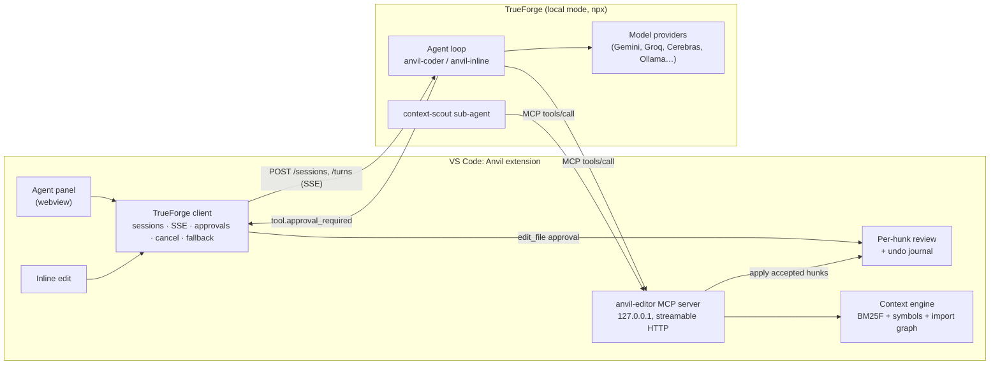

# Anvil

**An editor-native coding agent for VS Code whose agent loop runs on [TrueForge](https://github.com/truefoundry/trueforge).**

Built by **Team Asterix** for the TrueFoundry Forge-a-thon (Techfest 2026-27, IIT Bombay).

Anvil is a thin, careful client of a TrueForge agent. TrueForge runs the loop: sessions, turns, streaming, sub-agents, compaction and tool approvals. Anvil spends its effort on the two things that decide whether a coding agent works:

1. **What the model sees.** A budgeted, explainable context engine for repositories larger than any context window.
2. **What reaches disk.** Every edit is reviewed hunk by hunk, nothing is written silently, every applied change can be undone, and cancelled or failed runs discard uncommitted proposals while preserving already accepted edits in the undo journal.

| Capability | How Anvil does it |
|---|---|
| **Inline edit** | Select code, press <kbd>Cmd/Ctrl+Alt+I</kbd> and type an instruction. The replacement streams live into a review document, where you **accept or reject each hunk**. |
| **Agent mode** | A panel drives a TrueForge agent through a tool loop (`retrieve_context`, `search_code`, `find_symbol`, `read_file`, `edit_file`, `write_file`, `run_command`, …). You never name files: a `context-scout` **sub-agent** finds them. |
| **Context assembly** | `@file` / `@symbol` mentions, a ranked repo map on the first turn, and automatic **hybrid retrieval under a configurable estimated token budget**. The panel shows *which files were chosen and why*. |
| **Diff review** | TrueForge **tool approval drives the review**: an `edit_file` call pauses the turn, the hunks open in the editor, and only accepted hunks are applied. Changes can be undone per change or per run. |
| **Streaming & cancel** | Tokens render as TrueForge streams them. <kbd>Esc</kbd> or **Stop** cancels the TrueForge turn instantly, closes pending reviews and kills running commands. Partial edits are never applied. |
| **Resilience** | Transient model errors are retried with visible backoff. Auth errors or exhausted retries fall back **automatically to the next model configured in TrueForge**, with no user action and the workspace unchanged. |

---

## Architecture



- **The extension never calls a model provider.** It only talks to TrueForge (`@truefoundry/trueforge-sdk` plus the HTTP API) and serves MCP tools.
- **Editor capabilities are MCP tools.** TrueForge connects to Anvil's MCP server. The agent, not the extension, decides what to read and change.
- **Approval drives review.** `edit_file`, `write_file` and `run_command` are listed in `require_approval_for_tools`. When TrueForge pauses for approval, Anvil builds the proposal from the tool arguments and opens the per-hunk review. If at least one hunk is accepted, Anvil approves the call, and the MCP handler applies **only the accepted hunks**, telling the model exactly which hunks were rejected. If every hunk is rejected, the call is denied with that reason. An edit that was not reviewed is never written.
- **Agent definitions live in [`agents/`](agents/).** They are registered in TrueForge automatically (see below).

### TrueForge features used

| Feature | Where | Why |
|---|---|---|
| Sessions, turns, SSE streaming | every run | the loop, history and streaming come from the harness |
| Tool approval (`require_approval_for_tools`) | `edit_file`, `write_file`, `run_command` | the review gate is the harness's own pause, which has no time limit |
| **Dynamic sub-agents** | `anvil-coder` → `context-scout` | exploration happens in a disposable thread; the main thread gets a short "file:lines, why" list instead of 20 raw tool results |
| **Deferred tool loading** | `list_files`, `repo_map`, `get_diagnostics` | rarely used tools cost no prompt tokens until `list_tools`/`call_tool` loads them; core tools are preloaded |
| **Compaction** | `anvil-coder` (trigger 60k input tokens) | long sessions keep working after the window fills |
| Cancel / subscribe / session PATCH | Stop button, dropped streams, fallback | instant cancel, resume, and switching models inside the same session |

## Context strategy

The challenge's core problem is that pallets/flask (~17k LOC) does not fit in a context window, so what goes in matters. Anvil assembles context in three levels:

1. **Repo map (first turn, ~1.2k tokens).** A ranked outline of files and their top-level signatures (Aider-style). It is ranked by import in-degree and query relevance, so the model knows the landscape before it looks at any code.
2. **Explicit mentions.** `@file` attaches the whole file if it fits in 1.5k tokens, otherwise an outline. `@symbol` attaches the definition span.
3. **Automatic retrieval (`retrieve_context`, default ceiling 4,000 estimated tokens, transport cap 5,500).** This step uses no embeddings and makes no model calls:
   - **BM25F** over ~400-token chunks, with field weights path ×2.5, symbol names ×3, docstrings/comments ×1.2 and body ×1.
   - **Symbol-name boosts** for code identifiers in the request.
   - **Structural expansion**: test↔source pairing, docs whose sections mention the top files' symbols, a 1-hop import graph, and intent heuristics ("covered by a test" → include the best test file, "documented" → include the best docs file, "alongside the other X" → prefer files defining several sibling X).
   - **Budgeted selection**: full code spans when they fit and outlines otherwise, so a relevant file is never dropped silently. Every omission is recorded with its reason.
   - **Concrete evidence per file**, for example `defines run_command, shell_command, routes_command (click commands added in FlaskGroup.__init__)` or `test pair of src/flask/cli.py`.

The `context-scout` sub-agent calls `retrieve_context`, confirms with a few targeted `search_code`/`find_symbol`/`read_file` calls, and returns `path:start-end, why`. The panel renders every retrieval as a **context card** with a budget meter, the chosen files, the reasons and the omissions.

On the pinned Flask 3.1.3 fixture, the index contains 215 files and 2,817 chunks. The tests measure build/retrieval time on the current machine. For the Task B request, `src/flask/cli.py`, `tests/test_cli.py` and `docs/cli.rst` rank #1 to #3, using 3,946 of 4,000 tokens.

---

## Setup from a clean clone

**Prerequisites:** Node ≥ 22.14, VS Code ≥ 1.95, and Python ≥ 3.9 for the flask demo (`uv` optional).

```bash
git clone https://github.com/adityasarade/anvil-agent.git
cd anvil-agent
npm ci
npm run package                                   # builds anvil-agent.vsix
code --install-extension anvil-agent.vsix
```

You can also open the folder in VS Code and press <kbd>F5</kbd> to run it in an Extension Development Host.

### 1. Start TrueForge locally

```bash
npm run trueforge          # = scripts/start-trueforge.sh → npx @truefoundry/trueforge@0.185.1
```

This binds to `127.0.0.1:8790` (UI at http://127.0.0.1:8790), allowlists loopback so TrueForge can reach Anvil's local MCP server, and keeps paused turns alive while you review a diff. Leave it running.

### 2. Configure models in TrueForge

```bash
cp .env.example .env       # fill in your keys locally; setup registers them with local TrueForge
npm run setup              # registers providers + agents in TrueForge, prints the model chain
npm run setup -- --status  # health, providers, models, agents
```

- Providers are defined in [`config/models.example.json`](config/models.example.json) as TrueForge provider manifests with `${ENV}` placeholders. Copy it to `config/models.json` (git-ignored) to customise it.
- Any TrueForge provider works: catalog providers, any OpenAI-compatible endpoint, or a local Ollama. You can also add providers in TrueForge's Settings UI.
- **No key is committed and the extension never reads keys.**

### 3. Load the agent definitions

[`agents/anvil-coder.json`](agents/anvil-coder.json) and [`agents/anvil-inline.json`](agents/anvil-inline.json) are upserted into TrueForge **automatically** when the extension connects (and by `npm run setup`). `${PRIMARY_MODEL}` is replaced with the first model of your chain. The extension also registers its MCP server (`anvil-editor`, `http://127.0.0.1:43117/mcp`, per-activation header token).

### 4. Use it

Open any repository in VS Code. The status bar shows `Anvil: <model> +N fallback`; click it to choose the **model chain** (primary first, then fallbacks) from the models configured in TrueForge.

- **Inline edit:** select code → <kbd>Cmd/Ctrl+Alt+I</kbd> → instruction → review hunks (**✓ Accept / ✗ Reject** CodeLens, Accept all / Reject all in the title bar).
- **Agent mode:** Anvil icon in the activity bar → describe the change → watch the scout pick files → review each edit's hunks → approve commands. **Session ↗** opens the run in TrueForge's UI.
- **Undo:** the **Undo** button on the applied-change notification, **Undo** per change or **Undo all changes from this run** in the panel, or `Anvil: Undo Last Applied Change`.
- **Stop:** <kbd>Esc</kbd> or the red **Stop** button.

| Setting | Default | |
|---|---|---|
| `anvil.trueforgeUrl` | `http://127.0.0.1:8790` | TrueForge server |
| `anvil.models` | `[]` (= all configured) | ordered model chain, primary first |
| `anvil.retry.maxAttempts` | `3` | attempts per model for transient errors (1s/2s/4s backoff) |
| `anvil.context.budgetTokens` | `4000` | `retrieve_context` budget |
| `anvil.context.repoMapTokens` | `1200` | first-turn repo map budget |
| `anvil.mcp.port` | `43117` | MCP server port (next free port if busy) |

## Reproducing the Round 1 tasks (pallets/flask 3.1.3)

```bash
npm run demo:prepare    # clones tag 3.1.3 (22d92470), creates .venv (excluded locally), runs baseline checks
code .demo/flask
```

| Task | Instruction (verbatim) | Verify |
|---|---|---|
| **A. Inline edit** | In `src/flask/helpers.py`, select `get_debug_flag` and run: *Treat the values 'off' and 'n' as false as well, case-insensitively, and update the docstring to list every value that is treated as false.* | `FLASK_DEBUG=off python -c "from flask.helpers import get_debug_flag; print(get_debug_flag())"` prints `False` |
| **B. Agent mode** | In the panel, with no files named: *Add a new built-in CLI command flask config that prints the loaded application's configuration as JSON, masking the values of any key containing SECRET, PASSWORD, TOKEN or KEY as "\*\*\*". It must appear in flask --help, be covered by a test, and be documented alongside the other built-in commands.* | `pytest tests/test_cli.py -q` passes; `flask --app <any app> config` prints masked JSON; diff touches ≥ 3 files |
| **C. Resilience** | `npm run demo:failure -- --fallback provider/model`, select the printed chain, then repeat Task A in a separate clean fixture | Show retries, automatic fallback, and a responsive editor. **Reject the proposal** and show clean `git status`. Restore the normal chain, reconnect, and run `npm run demo:failure -- --remove`. |

To show an *unreachable endpoint* instead of a bad key, register a `custom` provider whose `base_url` points at a closed local port such as `http://127.0.0.1:9909/v1` and put it first in `anvil.models`. Anvil retries with backoff (1s, 2s) and then falls back.

## Models

No storage for local models? Use the [free cloud setup](docs/submission/free-cloud-models.md). Hosted Qwen is available through the existing Groq integration; OpenRouter's free router is an optional independent backup. The compact settings example reduces requests for limited free endpoints.

Anvil is provider-agnostic: it works with whatever TrueForge is configured with, and the chain is just an ordered list of TrueForge model names. The defaults in `config/models.example.json` are free-tier friendly:

| Role | Model (TrueForge name) | Where it runs | Cost | Notes |
|---|---|---|---|---|
| primary | `google-gemini/gemini-flash-lite-latest` | Google AI Studio API | account-dependent | example configuration; verify current access and quota in your own account |
| fallback | `groq/gpt-oss-120b` | Groq API (OpenAI-compatible) | account-dependent | example fallback; verify current access and quota in your own account |
| fallback 2 | `google-gemini/gemini-flash-latest` | Google AI Studio API | account-dependent | optional alternative; availability varies |
| optional | `cerebras/gpt-oss-120b`, `ollama/*` | Cerebras API / local Ollama | free tier / local | registered by `npm run setup` when their env vars are set |

Scripted-model integration checks require no model-provider calls. Record actual real-model usage and cost in your submission write-up; example configurations are not evidence of a completed live demo.

Switch models with **Anvil: Select Model Chain** (status bar), or edit `anvil.models`.


## Panel workflow

The Anvil panel has a theme-aware conversation view, compact tool activity, collapsible scout results, and a composer that grows with your message. Starter prompts fill the composer for you to edit before sending. Unsent text is kept locally using the editor webview state, so reopening the panel restores your draft.

Use **@** to mention a file or symbol. The **/** menu offers `/new`, `/model`, and `/session`; these run locally without spending model quota. **Latest** returns to the newest activity after you scroll up. Edit and command approvals, per-hunk review, and undo remain part of the workflow. The panel keeps Anvil’s own branding and is inspired by the compact conversation workflow documented for [Claude Code in VS Code](https://code.claude.com/docs/en/vs-code).

Run `npm run test:webview` to exercise the bundled panel in Chrome at narrow dark/light sidebar widths, including draft recovery, local commands, cancellation, tool activity, and approvals. It uses no cloud models; set `ANVIL_CHROME` if Chrome is installed elsewhere. Screenshots and results are saved under the ignored `.artifacts/` directory.

## Verification and submission

The [3:55 demo script](docs/submission/video-script.md) provides concise narration and screen actions. The [recording runbook](docs/submission/demo.md) contains the exact A/B/C prompts, acceptance commands, cleanup, and four-minute recording sequence. The [write-up template](docs/submission/writeup.html) follows all eight required headings; fill team information, actual models/costs, and real video timestamps before PDF export with `npm run writeup:pdf`.

For **Antigravity**, use **Extensions: Install from VSIX…** to install `anvil-agent.vsix`. F5 uses the included development launch configuration. `npm run test:extension` auto-detects the installed macOS Antigravity or VS Code CLI; set `ANVIL_EDITOR_CLI=/absolute/path/to/code` elsewhere. It uses an isolated test profile and reports the editor/version in `.artifacts/editor-result.json`.

Run `npm run demo:prepare` before `npm run verify:submission`. The default pinned fixture is `.demo/flask`; override it with `ANVIL_FLASK_ROOT`. Strict verification refuses a dirty fixture or skipped required integration tests, builds the VSIX, and launches the actual editor smoke test. It needs network access for the pinned TrueForge package on first use and permission to listen on localhost and launch the editor. Automated scripted-model success does **not** establish live-model completion of Tasks A, B, and C.

Read-only checks of agent-produced changes:

```sh
npm run demo:verify -- A
npm run demo:verify -- B
npm run demo:verify -- C --root .demo/flask-resilience
```

These commands check outcomes; they do not implement the task. Keep a separate clean fixture for C and for strict baseline checks. Preparation never resets an existing checkout. The local `.env`, `.demo/`, and `.artifacts/` are ignored, and demo files and the challenge PDF are excluded from the VSIX.

Limitations: one workspace folder per window; in-memory undo history; no command sandbox; provider-specific tool quality and quota; Python-oriented structural retrieval; character-based token estimates. Already accepted edits remain after cancellation. Approved commands and editor save participants can introduce effects outside a proposed hunk, so inspect the final diff. Standard VS Code requires a separate smoke run before it is claimed as tested.

## Starting point

**From scratch.** There is no upstream fork, so the entire repository is our delta, starting from the first commit.

We evaluated forking Continue, Cline, Roo Code and opencode for the editor side. Their chat UIs and diff viewers are tied to their own agent loops and state protocols, and TrueForge's event model (paused turns, approval events, sub-agent threads) maps poorly onto those protocols. A lean client against VS Code's APIs kept the code small enough to explain end to end. We studied Continue's per-block CodeLens accept/reject and Aider's repo map as design references; no code was copied.

## Development

```bash
npm run build        # esbuild: dist/extension.js + dist/webview.js
npm run typecheck
npm test                    # all available suites; optional dependencies may skip
npm run test:unit           # unit/context tests without a TrueForge process
npm run test:integration    # required live TrueForge + MCP tests (scripted model)
npm run test:flask          # required pinned-Flask retrieval tests
npm run test:extension      # actual editor activation, CodeLens, apply, undo, cancel
npm run verify:submission   # strict automated checks, packaging, real editor smoke test
ANVIL_LIVE_TASK=A npm run test:live  # opt-in real-model rehearsal, isolated editor profile
```

```
agents/            TrueForge agent definitions (anvil-coder, anvil-inline)
config/            model provider manifests (example; keys come from env)
scripts/           start TrueForge, register providers/agents, prepare the flask demo
src/context/       context engine: scan, Python/RST parsing, BM25F, graph, budgeted retrieval, repo map
src/trueforge/     TrueForge client: sessions, SSE → UI events, approvals, cancel, retry + fallback
src/mcp/           anvil-editor MCP server, tools, edit gate (approval → per-hunk review → apply)
src/review/        hunks, review documents with CodeLens, apply, undo journal
src/inline/        inline edit flow with streaming preview
src/panel/, src/webview/   agent panel
src/host/          prompt assembly (repo map, @mentions)
test/              vitest suites and fixtures
```

## Acknowledgements and tools

- Built on [TrueForge](https://github.com/truefoundry/trueforge) (MIT), the [MCP TypeScript SDK](https://github.com/modelcontextprotocol/typescript-sdk) (MIT), [jsdiff](https://github.com/kpdecker/jsdiff) (BSD-3-Clause) and [marked](https://github.com/markedjs/marked) (MIT).
- AI coding assistants used while building: Claude Code and OpenAI Codex. Declare the exact assistants and models actually used by the team in the final write-up.

## License

MIT. See [LICENSE](LICENSE).
